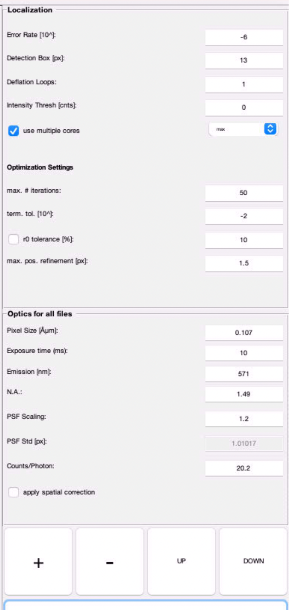
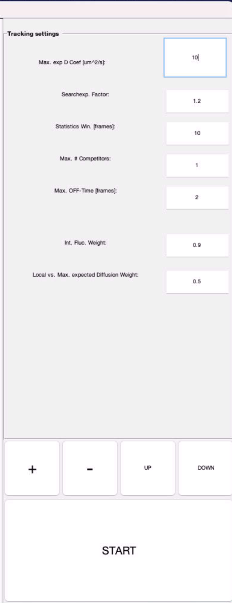

# Tracking in MATLAB (step 1.3)

Localisation and tracking are done with the MATLAB SLIMfast / evalSPT code (Coppey lab, 2018b versions),
not in Python. The code lives outside this repo (`matlab_tracker_dir` in `configs/paths.local.yaml`):

- `SLIMfast_batch2018bYasmina.m`: localisation, batch mode
- `evalSPT2018bYasmina.m`: tracking, batch mode

## How to run it

1. Crop the movies first (notebook 01, section 2). The cropped TIFFs are in `<cropped_dir>/data/Condition_*/`.
2. In MATLAB, add `matlab_tracker_dir` to the path and run `SLIMfast_batch2018bYasmina` on `<cropped_dir>/data`
   with the localisation settings below.
3. Run `evalSPT2018bYasmina` on the same folder with the tracking settings below.
4. Every cropped TIFF now has a `*_tracked.mat` next to it. Go back to notebook 01, section 4.

## Localisation

| Setting | Value |
|---|---|
| Error rate | 10^-6 |
| Detection box | 13 px |
| Deflation loops | 1 |
| Intensity threshold | 0 |
| Cores | max |
| Max iterations | 50 |
| Termination tolerance | 10^-2 |
| r0 tolerance | off (10 %) |
| Max position refinement | 1.5 px |
| Exposure | 10 ms |
| Emission wavelength | 571 nm |
| NA | 1.49 |
| PSF scaling | 1.2 |
| Counts per photon | 20.2 |

The screenshot shows a pixel size of 0.107 µm (it was taken from an ESC setup). The neuron data was acquired
at **0.065 µm per pixel**, which is what the pipeline uses (`acquisition.pixel_size_um` in `configs/pipeline.yaml`).
Set the pixel size in SLIMfast to match your camera. The Python loader converts pixels to µm itself, so
only the localisation fit uses this value.

## Tracking

| Setting | Value |
|---|---|
| Max expected diffusion coefficient | 10 µm²/s |
| Search expansion factor | 1.2 |
| Statistics window | 10 frames |
| Max competitors | 1 |
| Max OFF-time | 2 frames |
| Intensity fluctuation weight | 0.9 |
| Local vs max expected diffusion weight | 0.5 |
